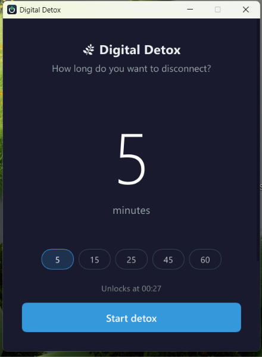

<p align="center">
  
</p>

<h1 align="center">Digital Detox</h1>

<p align="center">
  A small Windows app that locks your screen for a set amount of time, so you actually take that break.
</p>

---


## Features

- **Pick a duration** from 1 to 999 minutes, or use the quick presets (5, 15, 25, 45, 60 min)
- **Full-screen lock** that stays on top until the timer ends, with a countdown, progress bar and unlock time
- **All monitors covered**: secondary screens get their own overlay with the timer
- **Shortcuts blocked** while locked: Windows key, Alt+Tab, Alt+F4, Alt+Esc, Ctrl+Esc and Ctrl+Shift+Esc
- **A calming message** picked at random for each session
- **Unlocks automatically** when the time is up
- **Emergency exit** if you really need your computer back
- **Lightweight**: a single ~12 MB executable that uses about 5 MB of memory, no administrator rights needed

## Download

Grab the latest `DigitalDetox-vX.Y.Z-win-x64.zip` from the [Releases page](https://github.com/telcoray/DigitalDetox/releases), unzip it and run `DigitalDetox.exe`. Nothing else to install.

Since the executable isn't code-signed, Windows SmartScreen may warn you the first time: click **More info → Run anyway**.

## Build from source

Requires Windows 10 or 11, [Rust](https://rustup.rs/) (stable) and the Visual Studio C++ Build Tools (the Rust installer offers to install them).

```bash
git clone https://github.com/telcoray/DigitalDetox.git
cd DigitalDetox
cargo run
```

To create an optimized build (`target/release/digital-detox.exe`):

```bash
cargo build --release
```

The UI is drawn by [Slint](https://slint.dev/)'s software renderer, which keeps memory usage very low. To try the GPU-based Skia renderer instead (bigger executable, more memory, needs the Visual Studio **2022** C++ Build Tools):

```bash
cargo run --no-default-features --features skia
```

### Project layout

```
ui/          Slint files describing the windows (main window, lock screen, secondary monitors)
src/
  main.rs             app start-up and main window
  session.rs          one detox session: lock screen, timer, monitors, emergency exit
  keyboard_hook.rs    blocking of system shortcuts
  single_instance.rs  only one copy of the app at a time
assets/      logo and icon
```

## How to use



1. Enter how many minutes you want to disconnect, or click a preset
2. Click **Start Digital Detox**
3. Step away from the screen; it unlocks by itself when the timer reaches zero

### Emergency exit

Press **Ctrl+Shift+X** three times in a row (within 2 seconds of each other). An **Emergency Exit** button appears; click it and confirm to end the session early.

<br clear="right" />

## Limitations

Digital Detox is meant to help you keep a commitment, not to be an unbreakable lock. **Ctrl+Alt+Del** is handled by Windows itself and can't be blocked by any application, so it is always possible to sign out, lock or restart the PC.

## History

Version 2 is a rewrite in Rust with [Slint](https://slint.dev/). Version 1 was written in C# with WPF on .NET; its code is still available at the [`v1.0.1` tag](https://github.com/telcoray/DigitalDetox/tree/v1.0.1).

## License

[MIT](LICENSE)
