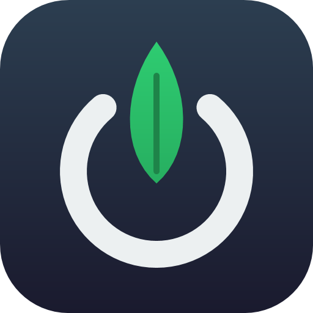
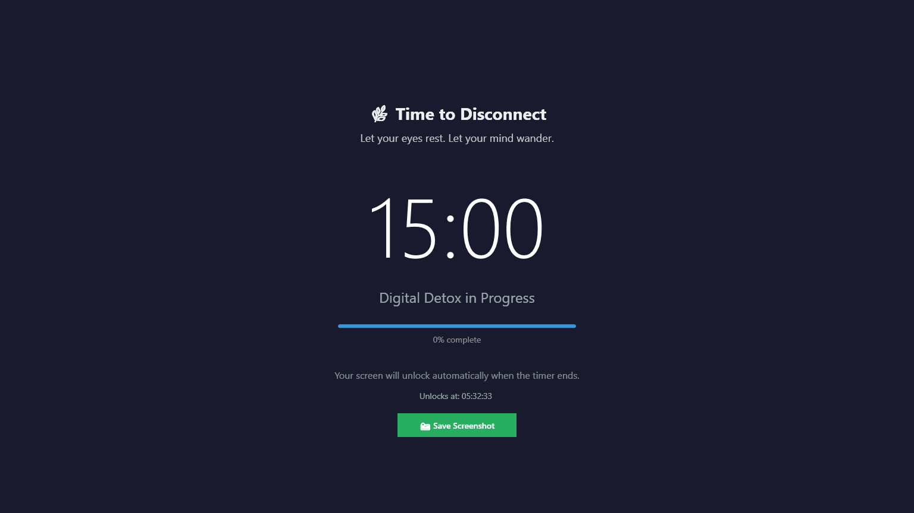

<p align="center">
  
</p>

<h1 align="center">Digital Detox</h1>

<p align="center">
  A small Windows app that locks your screen for a set amount of time, so you actually take that break.
</p>

---



## Features

- **Pick a duration** from 1 minute up to 24 hours, or use the quick presets (5, 15, 25, 45, 60 min)
- **Full-screen lock** that stays on top until the timer ends, with a countdown, progress bar and unlock time
- **All monitors covered**: secondary screens get their own overlay with the timer
- **Shortcuts blocked** while locked: Windows key, Alt+Tab, Alt+F4, Ctrl+Esc and Ctrl+Shift+Esc
- **A calming message** picked at random for each session
- **Unlocks automatically** when the time is up
- **Emergency exit** if you really need your computer back

## Requirements

- Windows 10 or 11
- [.NET 8 Desktop Runtime](https://dotnet.microsoft.com/download/dotnet/8.0) to run the app, or the .NET 8 SDK to build it

## Build and run

```bash
git clone https://github.com/<your-username>/DigitalDetox.git
cd DigitalDetox
dotnet run
```

To create a standalone build:

```bash
dotnet publish -c Release -r win-x64 --self-contained false
```

The app asks for administrator rights when it starts (UAC prompt).

## How to use

1. Enter how many minutes you want to disconnect, or click a preset
2. Click **Start Digital Detox**
3. Step away from the screen; it unlocks by itself when the timer reaches zero

### Emergency exit

Press **Ctrl+Shift+X** three times in a row (within 2 seconds of each other). An **Emergency Exit** button appears; click it and confirm to end the session early.

## Limitations

Digital Detox is meant to help you keep a commitment, not to be an unbreakable lock. **Ctrl+Alt+Del** is handled by Windows itself and can't be blocked by any application, so it is always possible to sign out, lock or restart the PC.

## License

[MIT](LICENSE)
